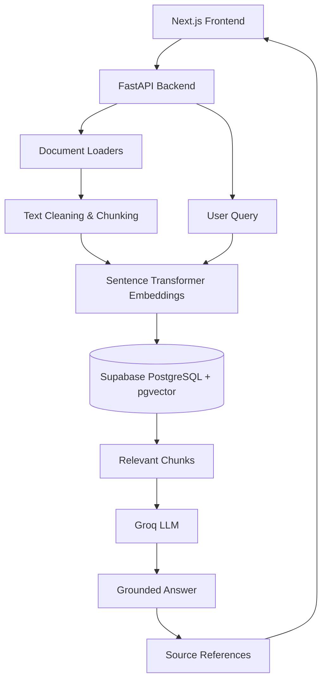
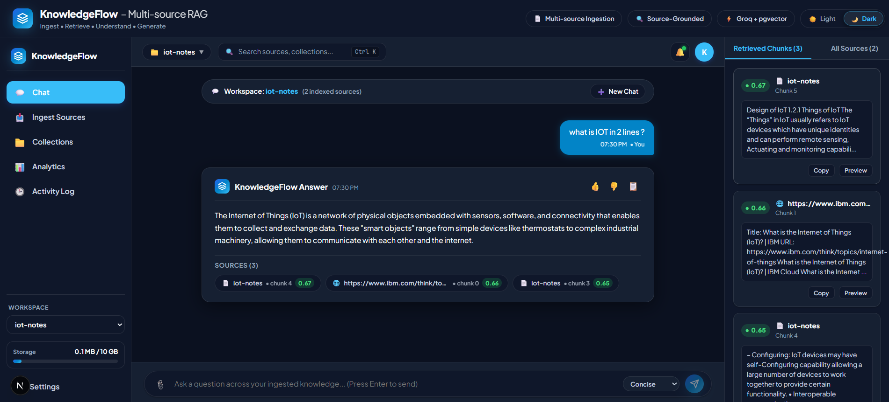
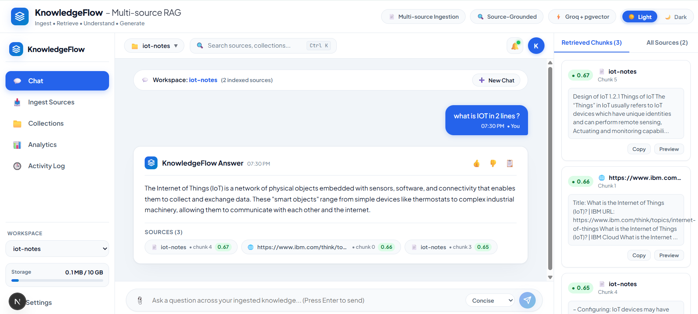
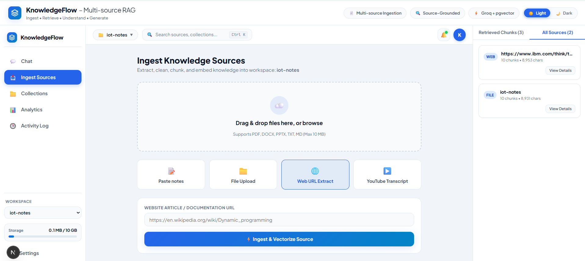
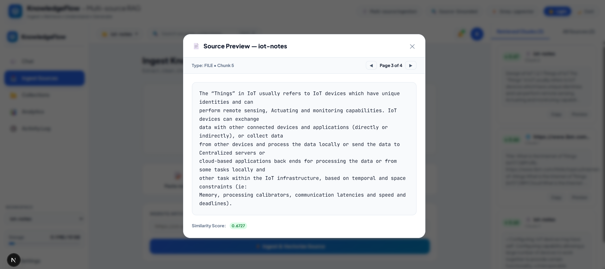
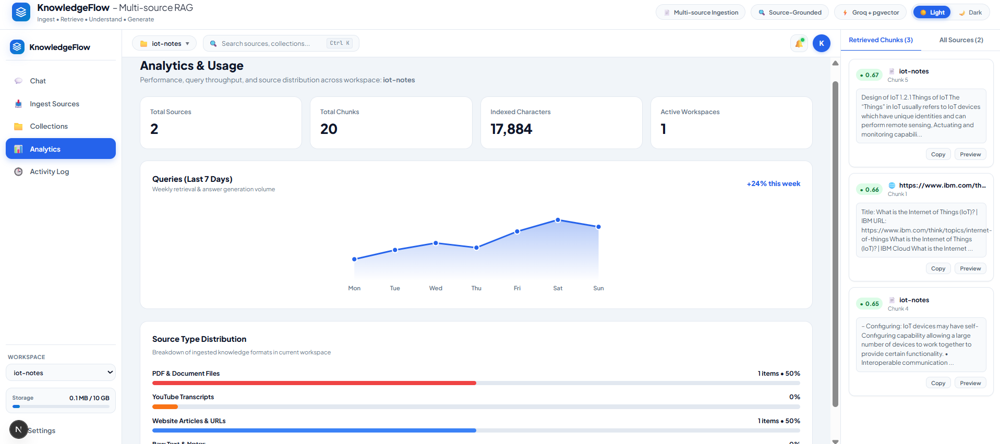

# KnowledgeFlow – Multi-Source RAG Assistant

KnowledgeFlow is a Retrieval-Augmented Generation (RAG) application that lets users upload documents, websites, text, and YouTube transcripts, then ask questions using context retrieved from their own sources.

It uses semantic search and vector storage to generate source-grounded answers with citations.

**Live Demo:** https://knowledgeflow-flax.vercel.app

## Features

- **Multi-source ingestion:** PDF, DOCX, PPTX, TXT, Markdown, websites, and YouTube transcripts.
- **Semantic search:** Generates embeddings using Sentence Transformers and retrieves relevant chunks.
- **Grounded responses:** Uses retrieved content to answer questions and display source references.
- **Collections:** Organizes documents into separate knowledge collections.
- **Response modes:** Standard, Student, Interviewer, Concise, Deep Research, and Code Focused.
- **Query protection:** Input guardrails and retrieval confidence checks.
- **Analytics:** Tracks document usage, query activity, retrieval confidence, and response metrics.
- **Streaming responses:** Displays generated answers as they are produced.
- **Themes :** Light and Dark themes for users.


## Tech Stack

| Component | Technology |
|---|---|
| Frontend | Next.js, React, JavaScript |
| Backend | Python, FastAPI |
| Embeddings | Sentence Transformers |
| LLM | Groq API |
| Database | Supabase PostgreSQL |
| Vector Search | pgvector |
| Document Processing | PyMuPDF, python-docx, python-pptx |
| Web & Video Extraction | BeautifulSoup4, YouTube Transcript API |
| Deployment | Vercel, Docker |

## Project Structure

```text
KnowledgeFlow/
├── assets/
│   └── screenshots/
├── backend/
│   ├── app/
│   │   ├── services/
│   │   │   ├── loaders/
│   │   │   ├── chunker.py
│   │   │   ├── embeddings.py
│   │   │   ├── rag.py
│   │   │   ├── text_cleaner.py
│   │   │   └── vector_store.py
│   │   ├── config.py
│   │   ├── main.py
│   │   └── schemas.py
│   ├── requirements.txt
│   └── .env.example
├── frontend/
│   ├── src/app/
│   │   ├── components/
│   │   ├── lib/
│   │   ├── page.js
│   │   └── layout.js
│   └── package.json
├── docker-compose.yml
├── vercel.json
└── README.md
```

## Getting Started

### Prerequisites

- Python 3.10+
- Node.js 18+
- Supabase account with PostgreSQL and pgvector
- Groq API key

### 1. Clone the repository

```bash
git clone https://github.com/Chethan13032005/KnowledgeFlow.git
cd KnowledgeFlow
```

### 2. Configure the backend

```bash
cd backend
python -m venv .venv
```

Activate the environment:

**Windows**
```powershell
.venv\Scripts\activate
```

**Linux / macOS**
```bash
source .venv/bin/activate
```

Install dependencies:

```bash
pip install -r requirements.txt
```

Create a `.env` file using `.env.example` and configure:

```env
GROQ_API_KEY=your_groq_api_key
DATABASE_URL=your_supabase_database_url
```

Set up the required database tables, vector extension, and retrieval functions in your Supabase database using the schema provided in the project.

Start the backend:

```bash
uvicorn app.main:app --host 127.0.0.1 --port 8000 --reload
```

API documentation: http://127.0.0.1:8000/docs

### 3. Configure the frontend

Open another terminal:

```bash
cd frontend
npm install
npm run dev
```

Open http://localhost:3000.

### 4. Run with Docker

Configure the backend environment variables, then run from the project root:

```bash
docker-compose up --build
```

## Architecture



## Screenshots

| Grounded Q&A – Dark Mode | Grounded Q&A – Light Mode |
|---|---|
|  |  |

| Multi-Source Ingestion | Retrieved Chunk Preview |
|---|---|
|  |  |

| Analytics Dashboard |
|---|
|  |


## API Endpoints

| Method | Endpoint | Purpose |
|---|---|---|
| GET | `/health` | Backend and database health |
| GET | `/analytics` | Usage statistics |
| GET | `/collections` | List collections |
| POST | `/ingest/text` | Ingest text |
| POST | `/ingest/file` | Upload documents |
| POST | `/ingest/url` | Ingest website content |
| POST | `/ingest/youtube` | Ingest YouTube transcripts |
| POST | `/query` | Ask questions using retrieved context |

## License

This project is licensed under the [MIT License](LICENSE).
