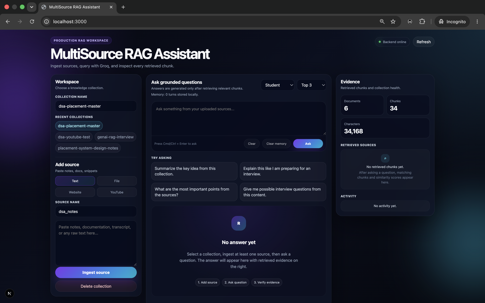
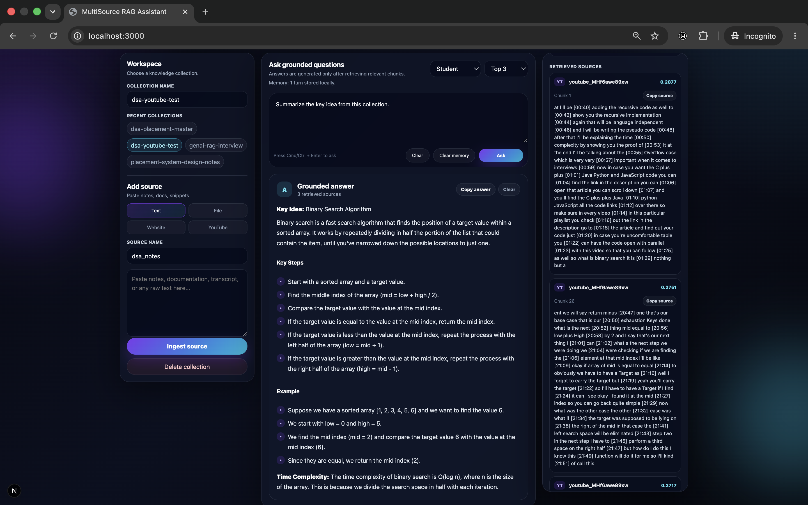

# KnowledgeFlow – Multi-source RAG Assistant

> **Ingest • Retrieve • Understand • Generate**
> *A production-grade, grounded AI assistant over your documents, web pages, and videos.*



KnowledgeFlow is an open-source Retrieval-Augmented Generation (RAG) platform. Ingest knowledge from PDFs, DOCX, PPTX, text notes, web articles, and YouTube transcripts into isolated collection workspaces, then ask semantically grounded questions with full source transparency and no hallucinations.

---

## ✨ Features

- **🌗 Light & Dark Themes** – Persistent theme preference, no flash on load.
- **📄 Multi-Source Ingestion**
  - Documents: PDF, DOCX, PPTX, TXT, Markdown
  - Web: Article scraping via BeautifulSoup4
  - Video: YouTube transcript extraction
  - Raw text / paste notes
- **🎯 Source-Grounded Answers** – Every answer cites exact source titles and cosine similarity scores.
- **🗂️ Collection Workspaces** – Isolated multi-tenant namespaces with per-collection stats.
- **👤 AI Personas** – Student, Developer, Interviewer, Concise.
- **📊 Analytics Dashboard** – Sources, chunks, characters, active workspaces.
- **🔍 Global Search (`Ctrl+K`)** – Instant search across collections and prompts.
- **📖 Source Preview Modal** – Inspect raw chunk content with pagination.
- **⚡ Ultra-low Latency** – Groq LPU inference (`qwen/qwen3.8-27b`).
- **🛡️ Enterprise Vector Storage** – Supabase Postgres + pgvector with HNSW indexing.
- **📱 Responsive Layout** – Desktop, tablet, and mobile (bottom nav on mobile).
- **🐳 Docker Compose** – One-command deployment.

---

## 🏗️ Architecture

```
                        ┌─────────────────────────┐
                        │   KnowledgeFlow Web UI   │
                        │   Next.js 16 (App Router)│
                        └───────────┬─────────────┘
                                    │ HTTP / JSON
                                    ▼
                        ┌─────────────────────────┐
                        │   FastAPI Backend (Python)│
                        └───────────┬─────────────┘
              ┌─────────────────────┴──────────────────────┐
              ▼ Ingestion Pipeline                         ▼ Query Pipeline
  ┌───────────────────────┐                   ┌───────────────────────┐
  │ Multi-Source Loaders  │                   │  User Query + Persona  │
  │ PDF|DOCX|PPTX|Web|YT  │                   └───────────┬───────────┘
  └───────────┬───────────┘                               │ embed
              │ raw text                                  ▼
              ▼                               ┌───────────────────────┐
  ┌───────────────────────┐                   │ SentenceTransformers   │
  │ Clean + Normalize     │                   │ all-MiniLM-L6-v2 (384d)│
  └───────────┬───────────┘                   └───────────┬───────────┘
              │                                           │ query vector
              ▼                                           │
  ┌───────────────────────┐                               │
  │ Sliding Chunk (650c,  │                               │
  │   120 overlap)        │                               │
  └───────────┬───────────┘                               │
              │ embed                                     │
              ▼                                           │
  ┌───────────────────────────────────────────────────────┴──┐
  │              Supabase Postgres + pgvector                  │
  │  rag_documents | rag_chunks | match_rag_chunks() [HNSW]   │
  └───────────────────────────┬──────────────────────────────┘
                              │ Top-K chunks (cosine similarity)
                              ▼
                  ┌───────────────────────┐
                  │       Groq API        │
                  │  qwen/qwen3.8-27b     │
                  └───────────┬───────────┘
                              │
                              ▼
                  ┌───────────────────────┐
                  │  Grounded Answer +    │
                  │  Source Citations     │
                  └───────────────────────┘
```

---

## 🗄️ Database Setup (Supabase / pgvector)

Run the following SQL in your **Supabase SQL Editor**:

```sql
-- 1. Enable pgvector extension
CREATE EXTENSION IF NOT EXISTS vector WITH SCHEMA extensions;

-- 2. Source document metadata table
CREATE TABLE IF NOT EXISTS rag_documents (
    id UUID PRIMARY KEY DEFAULT gen_random_uuid(),
    collection_name TEXT NOT NULL,
    source_type TEXT NOT NULL,
    source_name TEXT NOT NULL,
    source_url TEXT,
    content_hash TEXT,
    metadata JSONB DEFAULT '{}'::jsonb,
    created_at TIMESTAMPTZ DEFAULT NOW(),
    CONSTRAINT uq_collection_source UNIQUE (collection_name, source_type, source_name)
);

-- 3. Document chunks + vector embeddings table
CREATE TABLE IF NOT EXISTS rag_chunks (
    id UUID PRIMARY KEY DEFAULT gen_random_uuid(),
    document_id UUID REFERENCES rag_documents(id) ON DELETE CASCADE,
    collection_name TEXT NOT NULL,
    source_type TEXT NOT NULL,
    source_name TEXT NOT NULL,
    chunk_index INT NOT NULL,
    content TEXT NOT NULL,
    char_count INT NOT NULL,
    metadata JSONB DEFAULT '{}'::jsonb,
    embedding extensions.vector(384) NOT NULL,
    created_at TIMESTAMPTZ DEFAULT NOW()
);

-- 4. HNSW index for fast cosine similarity search
CREATE INDEX IF NOT EXISTS idx_rag_chunks_embedding_hnsw
ON rag_chunks
USING hnsw (embedding extensions.vector_cosine_ops)
WITH (m = 16, ef_construction = 64);

-- 5. Top-K semantic search function
CREATE OR REPLACE FUNCTION match_rag_chunks (
    query_embedding extensions.vector(384),
    target_collection TEXT,
    match_count INT DEFAULT 4
)
RETURNS TABLE (
    id UUID, collection_name TEXT, source_type TEXT, source_name TEXT,
    chunk_index INT, content TEXT, score FLOAT, metadata JSONB
)
LANGUAGE sql STABLE AS $$
    SELECT id, collection_name, source_type, source_name, chunk_index, content,
           ROUND((1.0 - (embedding <=> query_embedding))::numeric, 4)::float AS score,
           metadata
    FROM rag_chunks
    WHERE collection_name = target_collection
    ORDER BY embedding <=> query_embedding
    LIMIT match_count;
$$;
```

---

## 🚀 Getting Started

### Prerequisites

| Requirement | Version |
|---|---|
| Python | 3.10+ |
| Node.js | 18+ |
| [Supabase](https://supabase.com) account | Free tier works |
| [Groq Cloud](https://console.groq.com) API key | Free tier works |

---

### 1. Clone the repository

```bash
git clone https://github.com/your-username/knowledgeflow.git
cd knowledgeflow
```

### 2. Configure the backend

```bash
cd backend
cp .env.example .env
# Edit .env and fill in your GROQ_API_KEY and DATABASE_URL
```

**`backend/.env` variables:**

| Variable | Description |
|---|---|
| `GROQ_API_KEY` | Your Groq Cloud API key from [console.groq.com](https://console.groq.com) |
| `DATABASE_URL` | Supabase Postgres connection string (direct connection) |
| `GROQ_MODEL` | LLM model name (default: `qwen/qwen3.8-27b`) |
| `EMBEDDING_MODEL` | Embedding model (default: `sentence-transformers/all-MiniLM-L6-v2`) |
| `DB_POOL_MAX_SIZE` | Connection pool size (default: `5`) |
| `FRONTEND_ORIGIN` | CORS allowed origin (default: `http://localhost:3000`) |

### 3. Run locally

#### Backend (FastAPI)

```bash
cd backend

# Create and activate virtual environment
python -m venv .venv
# Windows:
.\.venv\Scripts\activate
# macOS / Linux:
source .venv/bin/activate

pip install -r requirements.txt
uvicorn app.main:app --host 127.0.0.1 --port 8000 --reload
```

API available at `http://127.0.0.1:8000`  
Swagger docs at `http://127.0.0.1:8000/docs`

#### Frontend (Next.js)

```bash
cd frontend
npm install
npm run dev
```

Open `http://localhost:3000` in your browser.

---

### 4. Docker Compose (one-command)

Ensure `backend/.env` is configured, then:

```bash
docker-compose up --build -d
```

| Service | URL |
|---|---|
| Frontend | `http://localhost:3000` |
| Backend API | `http://localhost:8000` |

---

## 📡 API Reference

| Method | Endpoint | Description |
|---|---|---|
| `GET` | `/health` | Health check – backend + database connectivity |
| `GET` | `/analytics` | Global stats: sources, chunks, character count |
| `GET` | `/collections` | List all collections |
| `GET` | `/collections/{name}/stats` | Stats for a specific collection |
| `GET` | `/collections/{name}/sources` | All sources in a collection |
| `DELETE` | `/collections/{name}` | Delete a collection and all its vectors |
| `POST` | `/ingest/text` | Ingest raw text or pasted notes |
| `POST` | `/ingest/file` | Upload PDF, DOCX, PPTX, TXT, or MD |
| `POST` | `/ingest/url` | Scrape and ingest a web article |
| `POST` | `/ingest/youtube` | Fetch and ingest a YouTube transcript |
| `POST` | `/query` | Semantic search + grounded answer generation |

---

## 🧱 Tech Stack

| Layer | Technology |
|---|---|
| **Frontend** | Next.js 16 (App Router), React 18, plain CSS variables |
| **Backend** | Python 3.10+, FastAPI, Uvicorn |
| **LLM** | Groq Cloud (`qwen/qwen3.8-27b`) |
| **Embeddings** | `sentence-transformers/all-MiniLM-L6-v2` (384-dim, local) |
| **Vector DB** | Supabase Postgres + `pgvector` (HNSW cosine index) |
| **Document parsing** | PyMuPDF, python-docx, python-pptx |
| **Web scraping** | BeautifulSoup4, httpx |
| **Video** | youtube-transcript-api |
| **Containerization** | Docker, Docker Compose |

---

## 📸 Screenshots

| Dashboard | Answer with Sources |
|---|---|
|  |  |

---

## 🤝 Contributing

1. Fork the repository
2. Create a feature branch: `git checkout -b feat/your-feature`
3. Commit your changes: `git commit -m "feat: add your feature"`
4. Push to your branch: `git push origin feat/your-feature`
5. Open a Pull Request

---

## 📄 License

This project is open-source. See [LICENSE](LICENSE) for details.
